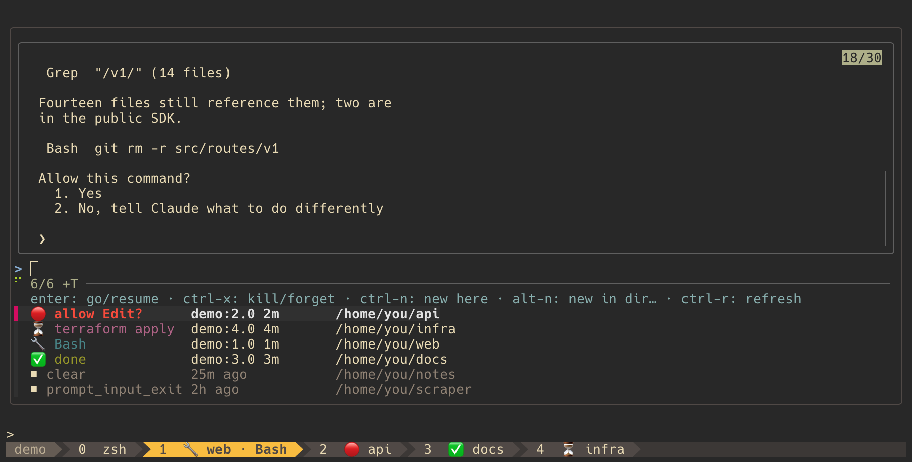
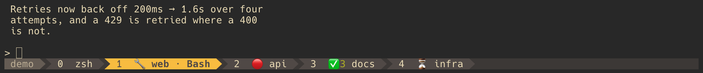

# tmux-claude-tabs

Shows what every Claude Code session is doing, in the tmux window it runs in.

Claude stays in your own windows and panes — no dedicated sessions, no popup to
open — and the state lives on the tab bar, always visible.



`prefix N` puts every Claude on the server in one popup — what needs you at the
top, its own screen previewed live above, ended sessions ready to resume.

And on the tab bar, all the time, without opening anything:



Window 2 is blocked on a permission answer. Window 3 holds three sessions and
all of them finished while you were away. Window 4 left a background job
running. Window 1 is the one you are in, and it is running `Bash`.

- **Badges** in each window's own block — spliced into whatever
  `window-status-format` your theme produced, so your status line is left
  alone and themes keep working.
- **A navigator** (`prefix N`): every Claude on the server in one popup — live
  ones with state and a screen preview, ended ones ready to resume.
- **Notifications** when a session you are not looking at finishes, errors out
  or starts waiting for you. `prefix J` steps through whatever needs you.

State comes from the session files Claude Code itself publishes. The default
install reads them and **touches nothing of Claude's** — no hooks, no
`settings.json`. Hooks are an [optional upgrade](#instant-updates-the-optional-hooks)
for instant, richer badges.

## Install

With [TPM](https://github.com/tmux-plugins/tpm): add the line **after your
theme**, press `prefix I`, then reload — TPM clones a new plugin but does not
load it.

```tmux
set -g @plugin 'timursevimli/tmux-claude-tabs'
```

```sh
tmux source-file ~/.tmux.conf
```

Needs tmux 3.2+, bash and `awk`. `fzf` is optional and makes the navigator
much better (search, live preview, directory picker) — without it you get a
plain tmux menu.

<details>
<summary>Without a plugin manager</summary>

```sh
git clone https://github.com/timursevimli/tmux-claude-tabs ~/.config/tmux/tmux-claude-tabs
```

Add to your config after whatever sets your status line, then reload:

```tmux
run-shell ~/.config/tmux/tmux-claude-tabs/claude-tabs.tmux
```

</details>

## Keys

| Key                               | Action                                  |
| --------------------------------- | --------------------------------------- |
| `prefix N`                        | open the navigator                      |
| `prefix J`                        | jump to the next session that needs you |
| `prefix M-c`                      | clear the current window's badge        |
| middle-click / double-click a tab | its state, without switching to it      |

The three prefix keys and the click menu are remappable — `'off'` releases any
of them (see [Options](#options)). The keys *inside* the navigator are fzf
bindings and can be added to or overridden — see
[Customizing the navigator keys](#customizing-the-navigator-keys).

## States

| Emoji | Label                         | When                                                                        |
| ----- | ----------------------------- | --------------------------------------------------------------------------- |
| 💤    | `idle`                        | started, nothing asked yet                                                  |
| 🔧    | `working` / `<Tool>`          | a turn is running (the tool name needs hooks; shown on the current window)  |
| 💭    | `thinking`                    | between tools _(hooks)_                                                     |
| 🤖    | `<agent>…`                    | a subagent is running _(hooks)_                                             |
| 📋    | `plan?`                       | plan mode waiting for approval _(hooks; 🔴 without)_                        |
| 🔴    | `needs you` / `allow <Tool>?` | **blocked** — permission prompt, elicitation, question                      |
| 📦    | `compacting`                  | context compaction _(hooks)_                                                |
| ⏳    | `bg shell` / job name         | the turn ended but background work is still running; clears when it settles |
| ✅    | `done`                        | turn finished, your move                                                    |
| ❌    | `<reason>`                    | turn died on an API error _(hooks)_                                         |

A digit after the badge is how many sessions the window holds — `✅3` — and
the emoji is always the most urgent of them. 🔴 means _blocked_, never merely
idle. ⏳ is not ✅: the session is busy on its own behalf, not waiting for you.

## The navigator

`prefix N` lists every Claude on the server: what needs you first, then what is
running, then finished, idle and ended. The list and the preview both refresh
while it is open.

The preview is a live capture of the selected session's screen; for an ended
session, the last replies from its transcript.

| Key      | Live session                                                                                                      | Ended session                       |
| -------- | ----------------------------------------------------------------------------------------------------------------- | ----------------------------------- |
| `enter`  | jump to its pane, in any tmux session                                                                             | new window there, `claude --resume` |
| `ctrl-x` | kill it (SIGTERM — stays resumable)                                                                               | forget the entry                    |
| `ctrl-n` | new Claude where you pressed `prefix N`                                                                           | same                                |
| `alt-n`  | new Claude in a directory you pick — recent project directories listed, the current one on top, any path typeable | same                                |
| `ctrl-r` | refresh                                                                                                           | same                                |

Ended sessions are recorded even after a SIGKILL or a crashed terminal — Claude prints the session id once at exit, and
this is where it lands.

## Notifications

When a session you are **not** looking at flips to `done`, `needs you`,
`plan?` or an error, a transient segment appears next to the window list:

```
✅ done · Projects:7 · J = jump
```

`@claude-tabs-notify-style 'message'` uses a tmux message instead;
`@claude-tabs-bell 'on'` also rings the pane's bell so your terminal notices
(both need hooks). `prefix J` walks every 🔴 📋 ❌, wrapping; when nothing
needs you it stays put and says so.

## Instant updates: the optional hooks

The default install polls Claude's session files: badges follow within
**2 s** while something runs, **10 s** from idle, and know four states —
working, waiting, background shell, idle. Claude Code's hooks make badges
**instant** and add the detail: tool names, 💭 🤖 📋 📦 ❌, and background
jobs named from the `Stop` payload (`Sleep for 25 seconds` instead of
`bg shell`).

This is an edit to `~/.claude/settings.json` — know what it does before
turning it on:

- appends **13 hook entries**, one per event, each running
  `hooks/claude-tabs.sh` from the plugin directory;
- backs the file up first (timestamped), keeps its permissions, leaves every
  other tool's hooks untouched; needs `jq`;
- re-runs on every tmux start, idempotently — a second run changes nothing;
- `hooks/install.sh --uninstall` removes exactly these entries.

```tmux
set -g @claude-tabs-auto-hooks 'on'
set -g @plugin 'timursevimli/tmux-claude-tabs'
```

Prefer to edit the file yourself? `hooks/install.sh --print` prints the JSON;
`hooks/install.sh --dry-run` shows the diff; `hooks/install.sh` applies it once, by hand.

## Options

Defaults shown. Set them before the plugin line.

```tmux
set -g @claude-tabs-nav-key        'N'       # navigator; 'off' unbinds
set -g @claude-tabs-jump-key       'J'       # next session needing you
set -g @claude-tabs-clear-key      'M-c'     # clear the current window's badge
set -g @claude-tabs-click-menu     'on'      # middle/double-click state menu
set -g @claude-tabs-current-label  'on'      # "· Bash" next to the current window's badge
set -g @claude-tabs-auto-hooks     'off'     # wire the Claude Code hooks on tmux start
set -g @claude-tabs-notify         'on'
set -g @claude-tabs-notify-states  'wait plan done error'
set -g @claude-tabs-notify-style   'status'  # 'status' segment | 'message' | 'off'
set -g @claude-tabs-notice-position 'right'  # where the segment goes: right | left | off
                                             # ('left' pushes the window list along)
set -g @claude-tabs-notify-duration '4000'   # ms
set -g @claude-tabs-bell           'off'     # also ring the pane bell (hooks)
set -g @claude-tabs-command        'claude'  # what ctrl-n / alt-n / resume run
set -g @claude-tabs-popup-width    '80%'
set -g @claude-tabs-popup-height   '75%'
set -g @claude-tabs-fzf-options    ''        # extra fzf flags for the navigator
set -g @claude-tabs-history-shown  '15'      # ended sessions listed
set -g @claude-tabs-history-limit  '200'     # ended sessions kept on disk
```

<details>
<summary>Tuning</summary>

```tmux
set -g @claude-tabs-poll            'on'   # the poller; 'off' leaves everything to hooks
set -g @claude-tabs-poll-every      '2'    # seconds between polls while something runs
set -g @claude-tabs-poll-idle-every '10'   # …when everything is idle
set -g @claude-tabs-popup-refresh   ''     # navigator refresh seconds (auto: 2, or 5
                                           # without session files; 0 = manual ctrl-r)
set -g @claude-tabs-sync-on-load    'on'   # seed badges when the plugin loads
set -g @claude-tabs-self-heal       'on'   # reconcile on window switch / attach
set -g @claude-tabs-sync-every      '20'   # min seconds between those reconciles
set -g @claude-tabs-stale-after     '20'   # seconds before a reconcile may overrule a badge
set -g @claude-tabs-watch-ticks     '500'  # how long to follow background work (~8 h)
```

</details>

### Customizing the navigator keys

`@claude-tabs-fzf-options` is passed straight to fzf, after the plugin's own
flags, so a `--bind` of yours wins. `$CLAUDE_TABS_NAV` is the navigator script,
exported for exactly this: `rows` reloads the list, `dispose {2} {3} {4}` kills
or forgets the highlighted entry. A vim-style layout:

```tmux
set -g @claude-tabs-fzf-options "\
  --prompt 'nav> ' \
  --bind 'j:down' \
  --bind 'k:up' \
  --bind 'q:abort' \
  --bind 'x:execute-silent(\$CLAUDE_TABS_NAV dispose {2} {3} {4})+reload(sleep 0.3; \$CLAUDE_TABS_NAV rows)' \
  --bind 'i:unbind(j,k,q,i,x)+change-prompt(filter> )' \
  --bind 'esc:rebind(j,k,q,i,x)+change-prompt(nav> )'"
```

`j`/`k` move, `x` kills like `ctrl-x`, `i` drops into fuzzy filtering, `esc`
comes back, `q` closes. Write `\$CLAUDE_TABS_NAV` inside the double-quoted
value so tmux stores a literal `$` (in a single-quoted value, a bare
`$CLAUDE_TABS_NAV`).

## Uninstall

```sh
~/.tmux/plugins/tmux-claude-tabs/hooks/install.sh --uninstall     # TPM
~/.config/tmux/tmux-claude-tabs/hooks/install.sh --uninstall    # manual clone
```

From any shell. It removes the hook entries from `settings.json` (if any) **and**
clears the spliced formats, key bindings, hooks and options from the running
server — the one you are in, or the default server when run from a plain
terminal. Then drop the `@plugin` line. A server on another socket needs
`claude-tabs.tmux uninstall` from inside it; without hooks that command alone
is the whole uninstall.

## What it writes

| Where                              | What                                                                                                                                                              | Removed by                   |
| ---------------------------------- | ----------------------------------------------------------------------------------------------------------------------------------------------------------------- | ---------------------------- |
| the tmux server                    | badge segments in both window-status formats, a notice segment in `status-right` (whose length it raises to 140 and restores on uninstall), nine hooks (self-heal, pane exit, pane move), the key bindings, one poller process | `claude-tabs.tmux uninstall` |
| `~/.local/share/tmux-claude-tabs/` | ended-session records, the current turn markers, one menu-row file per attached client, a sync lock; the trace log if you turn it on. Created mode 700 — it lists your project paths                                                                                                            | `rm -r`                      |
| `~/.claude/settings.json`          | **only with `auto-hooks` / `hooks/install.sh`:** the 13 hook entries                                                                                                    | `hooks/install.sh --uninstall`     |

**Trust boundary.** Everything this plugin reads — `~/.claude/sessions/`, its
own state under `~/.local/share/tmux-claude-tabs/`, hook payloads — is
written by your own user. It is trusted as such: a process that can write
there can already do anything you can. What is guarded is the other
direction, strings from those sources reaching something that *executes*:
tmux does not re-expand option values (so a tool named `#(…)` renders as
text), menu labels and command paths have their `#` doubled, a session id is
refused unless it looks like one before it reaches `claude --resume`, and a
pid is re-checked against `claude agents` before anything is signalled. The
history spool stores your project directories and transcript paths in plain
text, so the plugin creates its whole state directory mode 700 and tightens
one an older version left looser.

Nothing of Claude Code's is modified otherwise — no wrapper, no patched
binary. The hook script exits 0 on every path and can never block a tool; the
worst failure is a stale badge. The poller is one process that sleeps between
ticks, costs about 1 % of a core while a session runs (0.2 % idle), and exits
by itself — on its next tick, at most 10 s — when the server dies, a reload
replaces it, or `@claude-tabs-poll` is turned off. `"disableAllHooks": true` in `settings.json` is Claude Code's
own kill switch for every hook at once.

## Troubleshooting

| Symptom                 | Try                                                                                                                                                                                                       |
| ----------------------- | --------------------------------------------------------------------------------------------------------------------------------------------------------------------------------------------------------- |
| No badge at all         | Reload your config (TPM does not load a new plugin). Is the `@plugin` line **after** your theme? Does `~/.claude/sessions/` exist? With `auto-hooks`: is `jq` installed — the status line says so if not. |
| A badge will not settle | `scripts/navigator.sh sync force`                                                                                                                                                                         |
| One tab is wrong        | `prefix M-c`, or "Clear badge" in the click menu                                                                                                                                                          |
| Need to see what fired  | `scripts/navigator.sh trace on`, then `trace show`, then `trace off`                                                                                                                                      |

## How it works

- Claude Code writes one small JSON file per live session under
  `~/.claude/sessions/` — status, timestamp, exact tmux pane. One poller per
  server reads them (a quiet tick is ~20 ms of CPU) and reconciles only when
  something changed.
- With hooks, each event writes tmux user options on the pane _and_ its window
  directly — a hook is a child of Claude, so `$TMUX_PANE` is already there. A
  window with several Claudes shows the most urgent. Hooks stamp a "hooks are
  alive" marker; while it is fresh the poller defers to them, and older
  evidence never overrules newer.
- The badge is spliced into your theme's `window-status-format`, anchored on
  `#W`/`#T` (prepended when a theme has neither). Re-running strips the old
  segment first, so reloads never stack.
- The session-file format is undocumented, so parsing falls back on
  _fitness_: if a Claude update breaks it, state degrades to the documented
  `claude agents --json` and a notice says so. [`tests/`](tests/) has the
  regression suite and a contract check for your own install. Both pictures
  above are photographs of a real terminal, taken by
  [`docs/demo.sh --shot`](docs/demo.sh): invented projects on a tmux server of
  its own, badges painted by the real hook.

## Limitations

- Without hooks the badge follows the poll interval, not the event — up to 10 s
  from idle to 🔧.
- `Esc` fires no hook; a badge left on `working` is corrected by the next poll,
  window switch, or `sync force`.
- No spinner, no elapsed timer: badges repaint on change.
- Sessions that ended before the plugin was installed are not in the history
  (`claude --resume` still works).
- A Claude Code trust or onboarding dialog blocks a session while its file
  still says idle, so no badge can show it.
- **Two tmux servers can confuse each other.** `~/.claude/sessions` is shared
  between servers while pane ids are per-server, and a record names only
  `session:@window.%pane` — no server identity. A pane id is trusted here only
  when the session name matches as well, which is the strongest check the data
  allows: two servers that each have a session called `0` or `main` can still
  badge one another's panes. Nothing in the plugin can close this; it needs a
  server identity in the record.

## License

MIT
